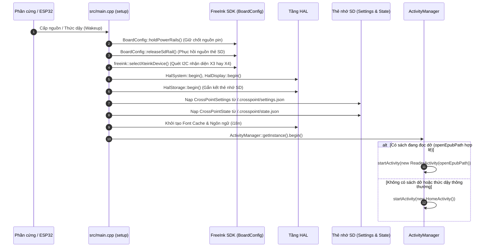
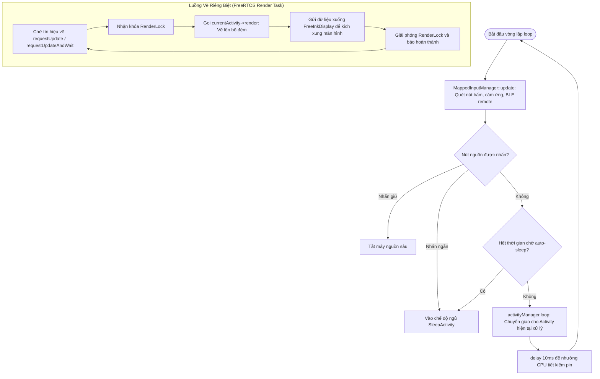
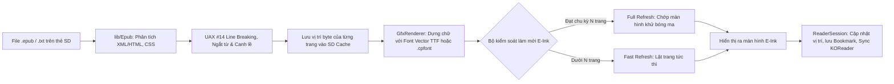

# Hướng Đường Đi & Kiến Trúc Phần Mềm CrossPoint Reader

Tài liệu này cung cấp bản đồ chi tiết về kiến trúc, luồng điều khiển (control flow), mô hình quản lý bộ nhớ và đường đi của dữ liệu trong firmware máy đọc sách **CrossPoint Reader**. Đây là cẩm nang định hướng cho việc nghiên cứu sâu hoặc tái cấu trúc (refactor/porting) phần mềm.

---

## 1. Bức Tranh Tổng Thể Kiến Trúc (Architecture Layers)

CrossPoint được xây dựng theo mô hình phân tầng chặt chẽ nhằm đảm bảo tính độc lập phần cứng và tối ưu hóa tài nguyên cho vi điều khiển nhúng (baseline là ESP32-C3 với ~380 KB RAM khả dụng, không PSRAM):

```mermaid
graph TD
    subgraph UI_Layer ["Tầng Giao Diện & Màn Hình (Activities)"]
        Home["HomeActivity (Màn hình chính)"]
        Reader["ReaderActivity / EpubReaderActivity (Đọc sách)"]
        Library["LibraryListActivity (Quản lý thư viện)"]
        Settings["SettingsListActivity (Cài đặt)"]
        Web["CrossPointWebServerActivity (Web UI / WebDAV)"]
    end

    subgraph Framework_Layer ["Tầng Khung Điều Phối (Application Framework)"]
        ActMgr["ActivityManager (Quản lý vòng đời & Ngăn xếp Activity)"]
        State["CrossPointState & Settings (Lưu trữ trạng thái & Cài đặt)"]
        InputMap["MappedInputManager (Ánh xạ phím, cảm ứng, BLE Remote)"]
        RenderTask["Render Task (Luồng vẽ E-Ink bất đồng bộ)"]
    end

    subgraph Core_Engines ["Tầng Động Cơ Cốt Lõi (Core Engines & Libraries)"]
        EpubEng["lib/Epub (Bộ phân tích & Dựng layout EPUB 2/3)"]
        Gfx["lib/GfxRenderer & EpdFont (Vẽ đồ họa & Font chữ)"]
        SyncEng["src/sync & KOReaderSync (Đồng bộ tiến độ đọc)"]
        ClipEng["src/clippings & StarDict (Ghi chú & Từ điển)"]
    end

    subgraph HAL_Layer ["Tầng Trừu Tượng Phần Cứng (HAL)"]
        HalDisp["HalDisplay"]
        HalInp["HalGPIO & Input"]
        HalPwr["HalPowerManager"]
        HalStore["HalStorage (SD Card)"]
    end

    subgraph FreeInk_SDK ["Tầng Nền Tảng FreeInk SDK & Drivers"]
        FDisplay["FreeInkDisplay (Facade)"]
        PDrivers["PanelDriver (SSD1677, UC8253, UC8179, UC8279...)"]
        BConfig["BoardConfig (Sơ đồ chân & Hồ sơ thiết bị)"]
        DevMgrs["SDCardManager, BatteryMonitor, InputManager..."]
    end

    UI_Layer --> Framework_Layer
    Framework_Layer --> Core_Engines
    Core_Engines --> HAL_Layer
    HAL_Layer --> FreeInk_SDK
```

---

## 2. Luồng Khởi Động Hệ Thống (Boot Sequence)

Toàn bộ quá trình khởi động bắt đầu từ hàm `setup()` trong [src/main.cpp](file:///g:/ebook_project/crossviet-reader/src/main.cpp):

### Các điểm mấu chốt trong giai đoạn Boot:
1. **Giữ nguồn khẩn cấp (`holdPowerRails`)**: Các bo mạch chạy pin cần kéo chân chốt nguồn (power-latch pin) lên mức tích cực ngay trong mili-giây đầu tiên, nếu không chip quản lý nguồn sẽ tự động cắt điện.
2. **Tự động nhận diện thiết bị (Hardware Fingerprint)**: Với dòng ESP32-C3, một file nhị phân duy nhất chạy cho cả Xteink X3 và X4. Hàm `selectXteinkDevice()` sẽ quét bus I2C để kiểm tra các linh kiện độc quyền của X3 (IC đo pin BQ27220, RTC DS3231, cảm biến gia tốc QMI8658) để chuyển đổi profile màn hình và driver tương ứng.
3. **Phục hồi phiên đọc**: `CrossPointState` lưu trữ đường dẫn cuốn sách đang mở dở. Nếu hợp lệ, hệ thống sẽ mở thẳng vào màn hình đọc sách để người dùng tiếp tục đọc ngay lập tức mà không cần qua màn hình Home.

---

## 3. Vòng Lặp Chính & Cơ Chế Đa Nhiệm (Main Loop & Concurrency)

CrossPoint vận hành mô hình đa nhiệm phối hợp giữa **Vòng lặp chính (`loop()`)** và **Luồng vẽ E-Ink (`renderTaskLoop`)**:

### Vì sao phải tách riêng Render Task?
- Màn hình E-Ink cần thời gian quét xung điện từ **200ms đến 1.5 giây** (tùy chế độ Fast hay Full refresh).
- Nếu việc vẽ chạy trực tiếp trong `loop()`, toàn bộ phím bấm và tương tác người dùng sẽ bị đóng băng.
- CrossPoint tạo một FreeRTOS task riêng chạy ở độ ưu tiên thấp hơn (`renderTaskLoop`) và đồng bộ bằng `RenderLock`. Khi Activity cần vẽ, nó chỉ cần gọi `requestUpdate()`, luồng render sẽ tự động chạy ngầm.

---

## 4. Quản Lý Màn Hình Hoạt Cảnh (Activity Framework)

Toàn bộ giao diện người dùng tuân theo mô hình **Single-Activity tại một thời điểm**:

### 1. Vòng đời của một Activity
- **`onEnter()`**: Khởi tạo tài nguyên của màn hình, chuẩn bị dữ liệu hiển thị.
- **`loop()`**: Được gọi định kỳ từ vòng lặp chính để xử lý sự kiện người dùng và tính toán logic.
- **`render(RenderLock&&)`**: Đổ nội dung (chữ, khung viền, icon) lên bộ đệm hiển thị thông qua `GfxRenderer`.
- **`onExit()`**: Dọn dẹp tài nguyên trước khi màn hình bị đóng hoặc tạm dừng.
- **`prepareForSleep()`**: Lưu trạng thái trước khi máy đi vào chế độ ngủ.

### 2. Ngăn xếp và chuyển đổi màn hình (Activity Stack)
- **`startActivity(new SubActivity(), resultCallback)`**: Đẩy Activity hiện tại vào stack, kích hoạt Activity con và đăng ký hàm nhận kết quả khi Activity con hoàn thành.
- **`finishActivity(result)`**: Đóng Activity hiện tại, giải phóng bộ nhớ của nó, kích hoạt lại Activity cha từ stack và truyền kết quả về `resultCallback`.
- **`replaceActivity(new Activity())`**: Thay thế trực tiếp Activity hiện tại (giải phóng ngay màn hình cũ để tránh chiếm dụng 2 màn hình cùng lúc trên RAM).

---

## 5. Đường Ống Đọc Sách (Reading Pipeline)

Màn hình đọc sách ([src/activities/reader/](file:///g:/ebook_project/crossviet-reader/src/activities/reader/)) là thành phần cốt lõi và phức tạp nhất của firmware:

### Các thành phần chính trong Reader:
1. **`ReaderActivity`** ([src/activities/reader/ReaderActivity.h](file:///g:/ebook_project/crossviet-reader/src/activities/reader/ReaderActivity.h)): Lớp trừu tượng quản lý chu kỳ lật trang, khử lưu ảnh (*ghosting*), menu đọc sách và kết nối điều khiển từ xa.
2. **`EpubReaderActivity`**: Hiện thực hóa việc đọc sách định dạng EPUB 2 và EPUB 3.
3. **Cơ chế Cache phân trang**: Việc tính toán ngắt dòng cho cuốn sách dài hàng trăm trang rất tốn CPU và RAM. Firmware chỉ tính toán và lưu bảng phân trang vào thư mục cache trên thẻ nhớ (`/.crosspoint/cache/`), các lần đọc tiếp theo sẽ mở trang ngay lập tức.
4. **Bộ nhớ đệm font chữ (`FontCacheManager`)**: Tối ưu hóa việc nạp glyph từ thẻ nhớ vào RAM để việc dựng chữ diễn ra mượt mà nhất.

---

## 6. Luồng Nhập Liệu & Quản Lý Nguồn (Input & Power Routing)

Firmware hỗ trợ đa dạng phương thức tương tác người dùng thông qua [src/MappedInputManager.h](file:///g:/ebook_project/crossviet-reader/src/MappedInputManager.h):

1. **Phím bấm vật lý**:
   - Các chân GPIO số trực tiếp.
   - **Thang đo điện trở ADC (ADC ladder)**: Nhiều nút bấm chia sẻ một chân ADC thông qua các điện trở khác nhau (giúp tiết kiệm chân GPIO quý giá trên ESP32-C3).
2. **Cảm ứng điện dung**:
   - Chạm vào mép màn hình: Lật trang trước / sau.
   - Chạm vào giữa màn hình: Mở Menu đọc sách hoặc thanh công cụ.
   - Thao tác vuốt (Swipe): Lật trang hoặc điều chỉnh độ sáng đèn nền.
   - Nhấn giữ từ: Kích hoạt tra từ điển StarDict offline hoặc bôi đen trích dẫn (Clipping).
3. **Thiết bị ngoại vi không dây**:
   - Remote lật trang Bluetooth BLE (nhận diện các nút `PageForward`, `PageBack` từ nhẫn/remote cầm tay).
4. **Chiến lược tiết kiệm pin (Power Management)**:
   - **Light Sleep (Ngủ nông)**: Giảm xung nhịp CPU trong các chu kỳ nhàn rỗi giữa các lần đọc nút bấm.
   - **Deep Sleep (Ngủ sâu)**: Tắt toàn bộ vi điều khiển, giữ hình ảnh màn hình chờ trên E-Ink (E-Ink không tốn điện khi hiển thị tĩnh). Đánh thức máy qua ngắt chân nút nguồn (RTC GPIO wakeup).

---

## 7. Bảng Tra Cứu Nhanh Các Thư Mục Quan Trọng

| Thư mục / File | Vai trò trong hệ thống |
| :--- | :--- |
| [src/main.cpp](file:///g:/ebook_project/crossviet-reader/src/main.cpp) | Khởi tạo phần cứng (`setup`), vòng lặp điều phối chính (`loop`). |
| [src/activities/ActivityManager.h](file:///g:/ebook_project/crossviet-reader/src/activities/ActivityManager.h) | Quản lý ngăn xếp màn hình và task vẽ E-Ink ngầm. |
| [src/activities/Activity.h](file:///g:/ebook_project/crossviet-reader/src/activities/Activity.h) | Lớp cơ sở định nghĩa vòng đời của các màn hình giao diện. |
| [src/activities/reader/](file:///g:/ebook_project/crossviet-reader/src/activities/reader/) | Hoạt cảnh đọc sách (EPUB, TXT, XTC), xử lý lật trang, bookmark, ghi chú. |
| [src/activities/home/](file:///g:/ebook_project/crossviet-reader/src/activities/home/) | Màn hình Home, danh sách sách gần đây, duyệt file. |
| [src/MappedInputManager.h](file:///g:/ebook_project/crossviet-reader/src/MappedInputManager.h) | Chuẩn hóa toàn bộ nút cứng, cảm ứng và remote BLE thành sự kiện logic. |
| [src/CrossPointSettings.h](file:///g:/ebook_project/crossviet-reader/src/CrossPointSettings.h) | Quản lý cài đặt người dùng (font, cỡ chữ, chế độ ban đêm, Wi-Fi...). |
| [src/CrossPointState.h](file:///g:/ebook_project/crossviet-reader/src/CrossPointState.h) | Quản lý trạng thái phiên làm việc (sách đang đọc dở, ảnh màn hình ngủ). |
| [lib/Epub/](file:///g:/ebook_project/crossviet-reader/lib/Epub/) | Thư viện phân tích định dạng EPUB, xử lý container, manifest, spine và CSS. |
| [lib/GfxRenderer/](file:///g:/ebook_project/crossviet-reader/lib/GfxRenderer/) | Thư viện đồ họa trung tâm: vẽ đường nét, hình chữ nhật, glyph font, hình ảnh. |
| [freeink-sdk/](file:///g:/ebook_project/crossviet-reader/freeink-sdk/) | Lớp HAL và driver màn hình E-Ink cho từng dòng máy (SSD1677, UC8253...). |
